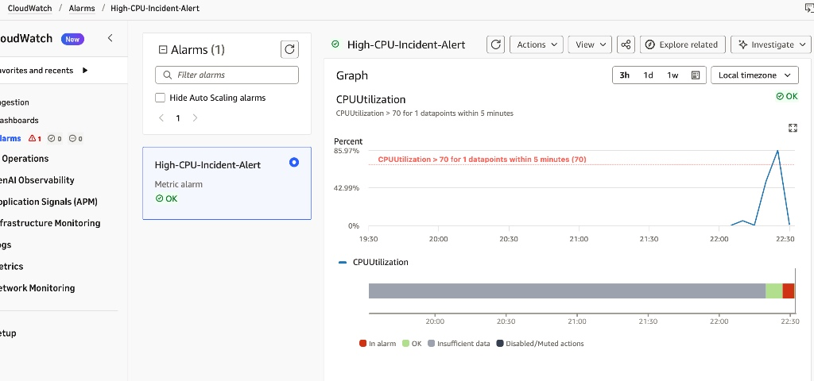
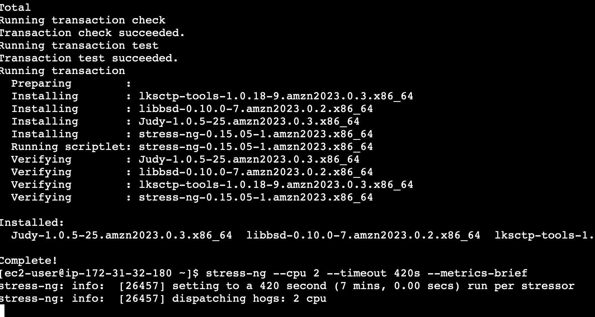
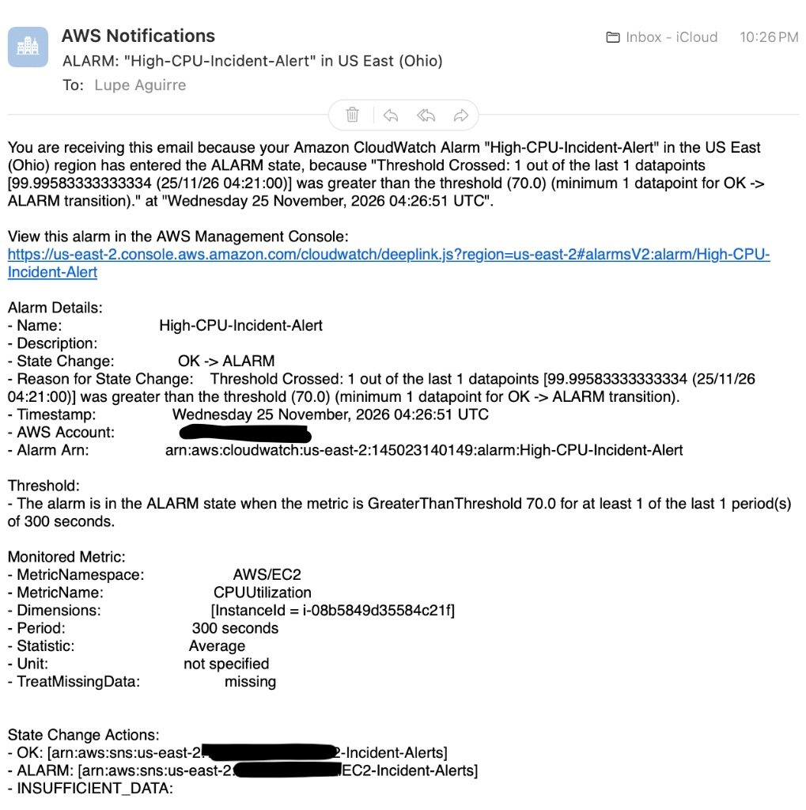
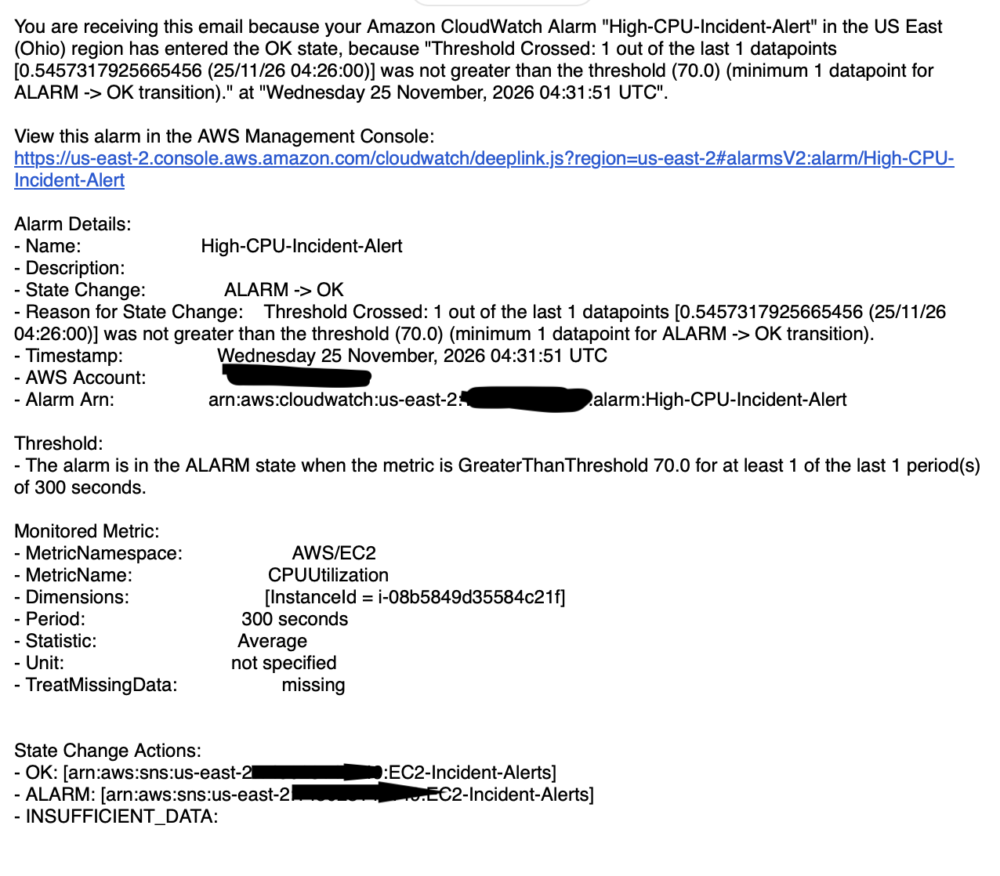

# AWS Automated System Alerts & Outage Response

A proactive cloud monitoring and incident alerting pipeline built on AWS using **Amazon EC2**, **Amazon CloudWatch**, and **Amazon SNS**. Designed to detect server performance spikes automatically, alert on-call engineers in real time, and confirm recovery once the load clears.

## How It Works
1. An **Amazon EC2** Linux server (`Amazon Linux 2023`) streams live `CPUUtilization` metrics to **Amazon CloudWatch**.
2. A **CloudWatch Alarm** (`High-CPU-Incident-Alert`) monitors for CPU usage crossing **70%** over a 5-minute window.
3. When breached, the alarm transitions from `OK -> ALARM` and triggers an **Amazon SNS** topic (`EC2-Incident-Alerts`) to email the on-call engineer immediately.
4. Once CPU usage returns to normal, the alarm transitions from `ALARM -> OK` and sends an automated recovery confirmation.

## AWS Services Used
- **Amazon EC2** (Monitored Linux compute instance)
- **Amazon CloudWatch** (Metric telemetry, threshold alarms, and state tracking)
- **Amazon SNS** (Automated email alerting for outage and recovery states)

## Incident Simulation & Verification
To validate the end-to-end alerting pipeline, I connected via EC2 Instance Connect, installed `stress-ng`, and ran a controlled 7-minute CPU load test (`stress-ng --cpu 2 --timeout 420s --metrics-brief`):
- **Breach Detected:** CPU spiked to **99.99%**, triggering the `OK -> ALARM` SNS email at `04:26:51 UTC`.
- **Auto-Recovery Confirmed:** After the load cleared, CPU dropped to **0.55%**, triggering the `ALARM -> OK` recovery email at `04:31:51 UTC` (5 minutes later).

## Proof of Execution

### CloudWatch Alarm Graph

### Simulated Load Test (`stress-ng` on EC2)

### Automated Outage Alert (`OK -> ALARM`)

### Automated Recovery Notification (`ALARM -> OK`)
 
